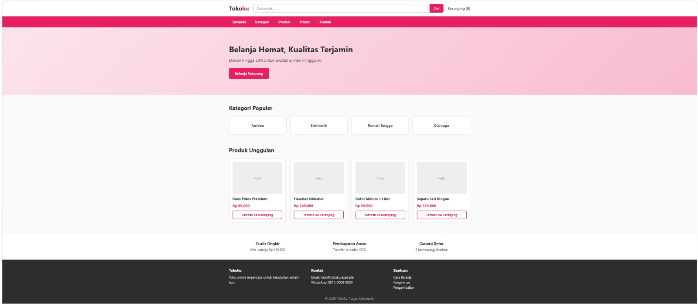
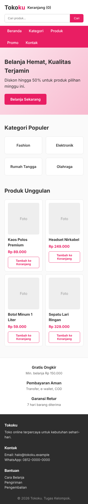

# Tugas Kelompok: Wireframe & Implementasi Web

> **Tema yang dipilih:** Toko Online ("Tokoku")
> **Kelompok:** _(isi nomor/nama kelompok)_
> **Anggota:** _(isi nama & NIM anggota)_

---

## 📁 Bukti Dikumpulkan

### 1. Source Code
| File | Keterangan |
|------|------------|
| `index.html` | Struktur halaman web (markup HTML semantik) |
| `style.css` | Styling dan tata letak, termasuk tampilan responsif desktop & mobile |

Tambahan: `wireframe.html` (wireframe desktop & mobile beserta anotasi fungsi area).

### 2. Tangkapan Layar
| Tampilan | File |
|----------|------|
| Desktop | `screenshots/desktop.png` |
| Mobile | `screenshots/mobile.png` |
| Wireframe + anotasi | `screenshots/wireframe.png` |

**Desktop**



**Mobile**



**Wireframe Desktop & Mobile**


### 3. Ringkasan

#### Solusi
Kelompok kami memilih tema Toko Online dengan nama "Tokoku". Wireframe dibuat dalam dua versi, desktop dan mobile, dan setiap area diberi nomor anotasi beserta fungsinya: logo (identitas dan kembali ke beranda), pencarian, keranjang, navigasi, banner promo, kategori, daftar produk, keunggulan toko, dan footer. Di desktop, kategori dan produk ditata empat kolom, sedangkan di mobile menjadi dua kolom dan bagian lain tersusun vertikal agar mudah dibaca di layar kecil.

Wireframe kemudian diterapkan menjadi halaman web. `index.html` memakai elemen semantik seperti `header`, `nav`, `main`, `section`, `article`, dan `footer` sehingga strukturnya sesuai nomor anotasi. `style.css` mengatur tampilan dengan Flexbox untuk header dan navigasi serta CSS Grid untuk kategori, produk, dan footer. Responsivitas dibuat dengan media query pada lebar 900px dan 600px. Hasilnya diuji pada tampilan desktop (1280px) dan mobile (390px) dan didokumentasikan lewat tangkapan layar.

#### Pembagian Peran
| Nama Anggota | Peran / Tanggung Jawab |
|--------------|------------------------|
| _(Nama 1)_ | Wireframe desktop & anotasi |
| _(Nama 2)_ | Wireframe mobile & anotasi |
| _(Nama 3)_ | Penulisan HTML (`index.html`) |
| _(Nama 4)_ | Penulisan CSS (`style.css`), tangkapan layar & laporan |

---

## 🚀 Cara Menjalankan
1. Unduh atau clone repositori ini.
2. Pastikan `index.html` dan `style.css` berada dalam satu folder.
3. Buka `index.html` di browser.

## 🗂️ Struktur Folder
```
.
├── index.html
├── style.css
├── wireframe.html
├── screenshots/
│   ├── desktop.png
│   ├── mobile.png
│   └── wireframe.png
└── README.md
```
